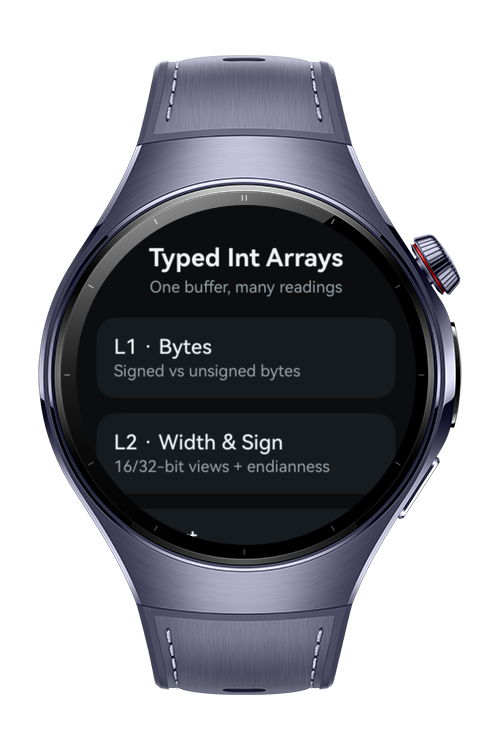
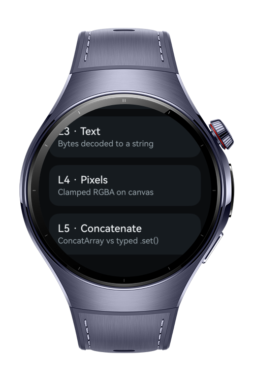
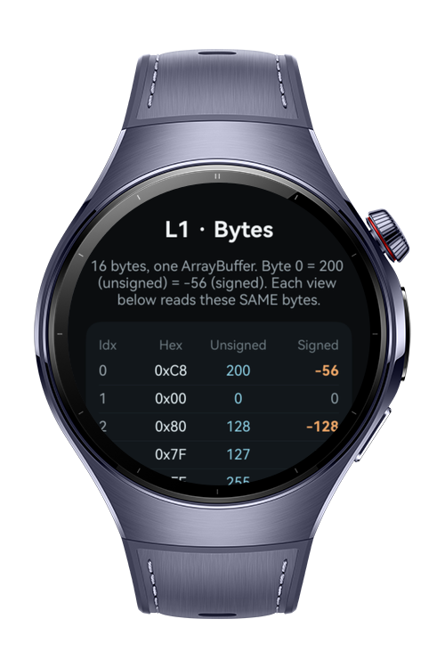
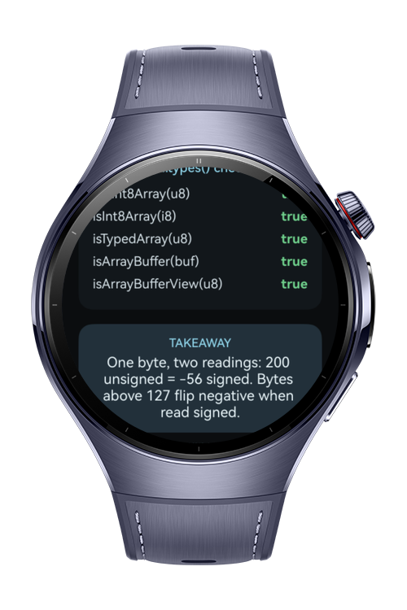

> **Note:** To access all shared projects, get information about environment setup, and view other guides, please visit [Explore-In-HMOS Index](https://github.com/Explore-In-HMOS/hmos-index).

# How To Build Typed Int Arrays

**How To Build Typed Int Arrays** (`how_to_build_typed_int_arrays`) is a HarmonyOS wearable app that demonstrates ArkTS typed integer arrays and binary buffers: how a single `ArrayBuffer` can be reinterpreted through `Int8Array`/`Uint8Array`, 16- and 32-bit views, `Uint8ClampedArray`, `DataView` endianness, the `util.types` runtime checks, `util.TextEncoder`/`util.TextDecoder`, and `collections.ConcatArray` from `@kit.ArkTS`.

The app is organized as a lesson index that navigates into five focused screens. One shared 16-byte buffer is read as signed and unsigned bytes, then as wider integers with little- vs big-endian order, decoded into text, rendered as clamped RGBA pixels on a canvas, and finally used to contrast array concatenation styles.

# Preview

<div>
  
  
  
  
</div>

# Use Cases

- **Signed vs unsigned bytes**: Reads the same buffer through `Int8Array` and `Uint8Array` and verifies views with `util.types` predicates.
- **Width and endianness**: Views the buffer as 16- and 32-bit integers and reads bytes with `DataView` to compare little-endian and big-endian order.
- **Bytes to text**: Turns `Uint16Array` code units into a string via `util.TextDecoder('utf-16le')` and round-trips text with `util.TextEncoder`.
- **Clamped pixels**: Builds an RGBA `Uint8ClampedArray` grid and renders it to a canvas with `ImageData`/`putImageData`, using invert and brighten filters to make clamping visible.
- **Array concatenation**: Contrasts `collections.Array.concat` over `collections.ConcatArray<number>` with joining built-in typed arrays through allocation plus `.set()`.

# Technology

## Stack

- **Languages**: ArkTS / ArkUI
- **Frameworks**: HarmonyOS SDK 6.0.1(21)
- **Tools**: DevEco Studio 6.x+
- **Libraries**:
  - `@kit.ArkTS`
  - `@kit.ArkUI`
  - `@kit.BasicServicesKit`

## Required Permissions

No permission required.

# Directory Structure

```
entry/src/main/ets/
|---binary
|   |---ConcatDemo.ets
|   |---PixelBuffer.ets
|   |---SamplePayload.ets
|   |---TextCodec.ets
|   |---TypedArrayInspector.ets
|---common
|   |---components
|   |   |---ByteRow.ets
|   |   |---LessonScaffold.ets
|   |   |---TakeawayCard.ets
|   |---constants
|   |   |---LessonRoutes.ets
|   |---util
|   |   |---AppNavigator.ets
|---entryability
|   |---EntryAbility.ets
|---pages
|   |---Index.ets
|   |---RouteBuilders.ets
|   |---LessonIndex.ets
|   |---BytesLesson.ets
|   |---WidthSignLesson.ets
|   |---TextLesson.ets
|   |---PixelsLesson.ets
|   |---ConcatLesson.ets
```

# Constraints and Restrictions

## Supported Devices

- Huawei Watch 5
- DevEco Studio wearable simulator

# License

**How To Build Typed Int Arrays** is distributed under the terms of the MIT License.
See the [LICENSE](/LICENSE) for more information.
